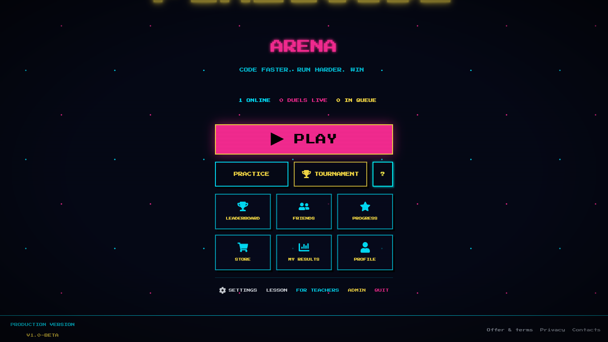
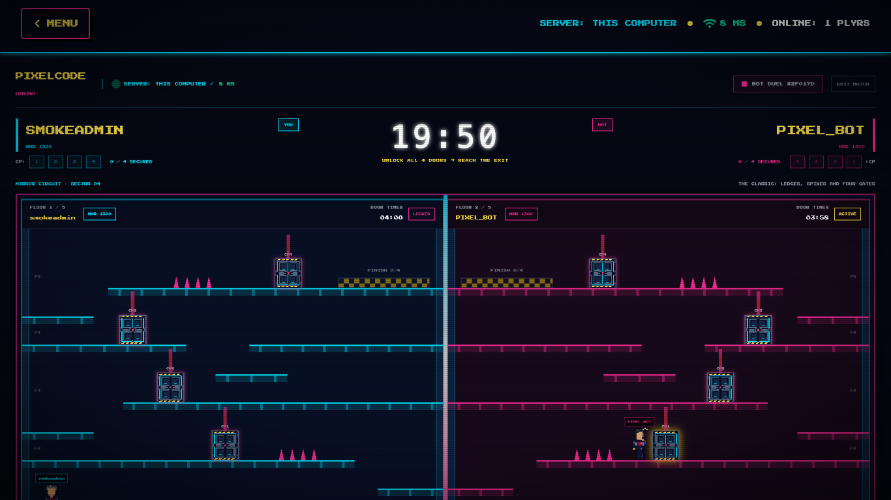
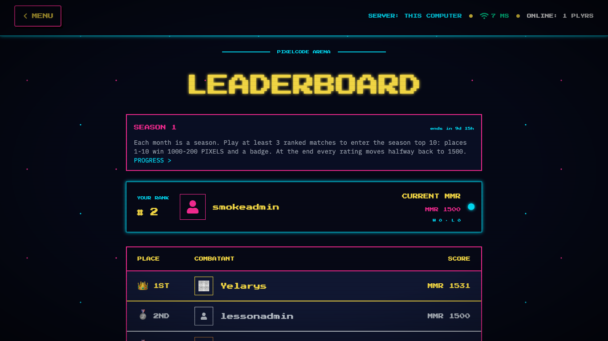
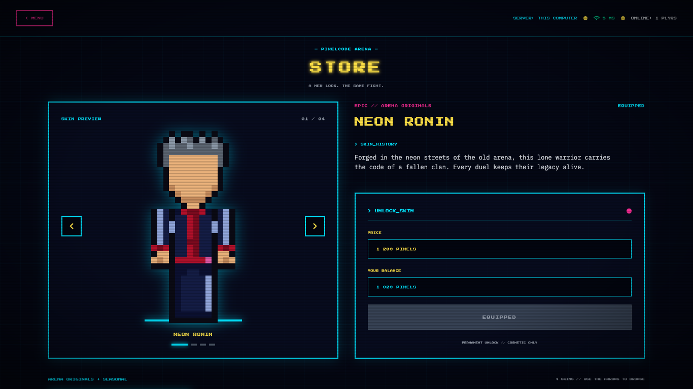
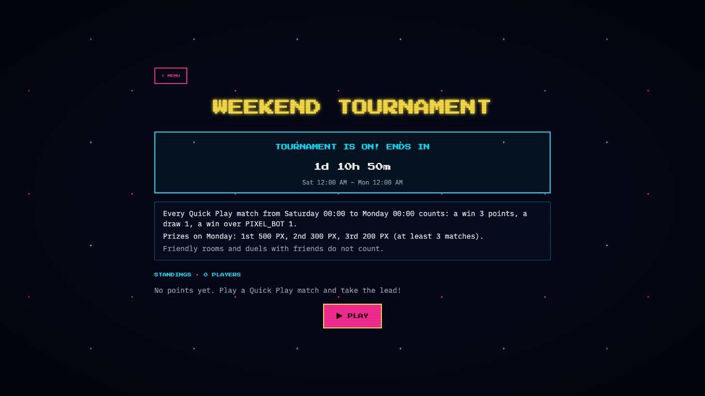

# PixelCode Arena

A real-time 1v1 browser game where two players race down a pixel platform level and unlock every door by solving a short Java programming challenge.

**Play it:** https://pixelcode-arena.onrender.com (backend: https://pixelcode-api.onrender.com/api/health)
The free server sleeps after 15 minutes without players: the first visit can take up to a minute.



## The problem and who it is for

Learning to code alone is slow and boring for many school and university students: exercises have no time pressure, no opponent and no reason to come back tomorrow. PixelCode Arena turns short coding tasks into a duel: you see your rival running beside you, and every correct solution opens the next door.

- **Students (13+) learning programming** who want practice that feels like a game.
- **Teachers** who want a live coding race for the whole class (teacher mode: join by code or QR, a shared map, the teacher's own tasks, a live class table).

## Features

**Core match (all Must stories of the SRS)**
- Registration, sign-in, password reset by e-mail, sign-out.
- Quick Play matchmaking by rating (Elo), versus screen, five-minute join window.
- Two side-by-side panels on the same map, live opponent position over WebSocket.
- Four doors per match: a Java challenge (EASY / MEDIUM / HARD by the players' level), checked on the server in a sandbox; a door opens by itself after 4 minutes.
- Server decides the winner; rating changes once; reconnect within 5 minutes, otherwise a ban and a technical loss.
- Admin panel: add / withdraw challenges (validated against a reference solution), publish skins, challenge statistics.

**Beyond the SRS**
- PIXEL_BOT opponent when nobody is in the queue (it really plays the level); newcomers meet a gentler bot within seconds.
- Practice mode: free run, or doors with real tasks.
- Leaderboard, monthly seasons, daily quests, achievements, daily login streak.
- Store with animated 32x16 pixel skins and an admin pixel editor.
- Friends, duel invitations, blocking, spectator mode for friends' matches, emotes and quick phrases, match replays.
- Best solutions of each challenge (shortest / fastest), weekend tournament with prizes.
- 14 interface languages (including Kazakh and Russian, right-to-left Arabic and Urdu), mobile touch controls.

| Match | Leaderboard |
| --- | --- |
|  |  |
| **Store** | **Weekend tournament** |
|  |  |

## Tech stack

| Part | Technology |
| --- | --- |
| Frontend | React 19, React Router 8 (SPA mode), TypeScript, Tailwind CSS 4, Vite, STOMP over WebSocket, i18next |
| Backend | Java 21, Spring Boot 4 (Web, WebSocket/STOMP, Data JPA, Mail), Maven |
| Code checking | Player code compiled with `javac` and run in a separate locked-down JVM (time and memory limits, allow-list of classes) |
| Database | PostgreSQL (Neon in production, Postgres 16+ locally) |
| Hosting | Render (static site + Docker web service), Neon (database), GitHub Actions (weekly encrypted backup) |

```
Browser (React SPA) --HTTPS REST /api--> Spring Boot backend --JPA--> PostgreSQL
        \--WebSocket /ws (STOMP: moves, doors, emotes)--/   \--child JVM: runs player code
```

## Run it locally (about 10 minutes)

You need **Java 21**, **Node.js 20+** and **PostgreSQL 16+** (on macOS the easiest is [Postgres.app](https://postgresapp.com)).

1. Clone and create the databases:
   ```bash
   git clone https://github.com/elaryscj/PixelCode.git
   cd PixelCode
   createdb -U postgres game_db          # the game data
   createdb -U postgres pixelcode_test   # only for the automated tests
   ```
   The backend expects user `postgres` with password `root` on `localhost:5432`. If yours differ, set `DB_USER` / `DB_PASSWORD` before step 2.
2. Start the backend (first start downloads Maven dependencies, 2-3 minutes):
   ```bash
   cd backend
   ADMIN_USERNAMES=admin ./mvnw spring-boot:run      # Windows: set ADMIN_USERNAMES=admin && mvnw spring-boot:run
   ```
   Check: http://localhost:8080/api/health answers `{"status":"ok"}`. Tables and the 42 built-in challenges are created automatically.
3. In a second terminal start the frontend:
   ```bash
   cd frontend
   npm install
   npm run dev
   ```
4. Open http://localhost:5173, register an account named `admin` (it gets the ADMIN button), press PLAY. With nobody else in the queue PIXEL_BOT joins in a few seconds.

Alternative: the whole stack in Docker (`cp .env.example .env`, fill it in, `docker compose up -d --build`, open http://localhost). See [docs/DEPLOY.md](docs/DEPLOY.md).

## Environment variables

All secrets live in environment variables (never in the code). Copy `.env.example` to `.env` for Docker; on Render they are set in each service's Environment tab.

| Variable | Needed | Meaning |
| --- | --- | --- |
| `DB_URL` or `DB_HOST` / `DB_PORT` / `DB_NAME` | yes (prod) | PostgreSQL address (`jdbc:postgresql://...`) |
| `DB_USER`, `DB_PASSWORD` | yes (prod) | database login |
| `TOKEN_SECRET` | yes (prod) | long random string that signs login tokens (`openssl rand -hex 32`) |
| `ADMIN_USERNAMES` | no | comma-separated usernames that get administrator rights |
| `FRONTEND_URL`, `BACKEND_URL` | prod | public addresses (password-reset links, payment callbacks) |
| `CORS_ORIGINS` | prod | site address allowed to call the API |
| `BREVO_API_KEY`, `MAIL_FROM` | no | password-reset e-mails through Brevo (or `MAIL_HOST`, `MAIL_PORT`, `MAIL_USER`, `MAIL_PASSWORD` for SMTP) |
| `SERVER_REGION` | no | shown in the header (e.g. `frankfurt`) |
| `BAN_MINUTES` | no | ban length for an abandoned match (default 30) |
| `TEACHER_PRICE_MONTH`, `TEACHER_PRICE_YEAR`, `TEACHER_CURRENCY`, `TEACHER_TRIAL_DAYS` | no | teacher subscription prices |
| `FREEDOM_MERCHANT_ID`, `FREEDOM_SECRET_KEY`, `FREEDOM_TESTING` | no | online payment (off until set) |
| `VITE_API_URL`, `VITE_WS_URL` | frontend build (prod) | backend addresses, e.g. `https://pixelcode-api.onrender.com/api` |

## Tests

```bash
cd backend && ./mvnw test        # 54 tests; needs the local database "pixelcode_test"
cd frontend && npm run typecheck # TypeScript check of the whole frontend
```
The backend tests cover the code sandbox, all 42 catalog challenges (each reference solution must pass), map geometry, the bot's pathfinding, store purchases under concurrency, the payment flow, lessons, access rules for replays and profiles, the tournament calendar and the translations.

## Project documents

- [docs/SRS.md](docs/SRS.md): requirements with the status of every user story.
- [docs/DEPLOY.md](docs/DEPLOY.md): deployment to Render + Neon, backups and restore.
- [docs/STATUS.md](docs/STATUS.md): detailed feature list and where to find each feature.

## Team

| Member | Role |
| --- | --- |
| Yelarys | UI/UX design, project lead |
| Nurassyl | Frontend |
| Arman | Backend |
| Dauren | Backend |

Code freeze: to be announced (Week 13).
