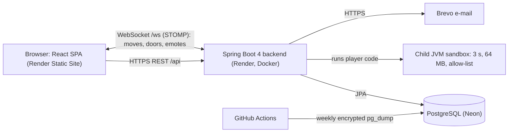
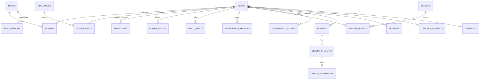

# Pixel Code Software Requirements Specification

**Version:** 1.0 (as built, Week 12, 21 November 2026). Version 0.2 was the draft before implementation.  
**Project:** Pixel Code (PixelCode Arena), a competitive two-player browser game  
**Purpose:** Requirements of the first release and the status of every user story in the deployed product.  
**Deployed:** https://pixelcode-arena.onrender.com  
  
**Status legend:** **Done** = works in production as the acceptance criteria say; **Partial** = works, but differs from the criteria (reason given); **Deferred** = not in this release (reason given). A summary is in Section 8.

## 1. Introduction

Pixel Code is a real-time 1v1 browser game. Each player joins from a separate device and races down an equivalent vertical platform map. A locked metal door blocks each floor. A player can unlock that door by solving a short, easy programming challenge; if the door remains locked for four minutes after the challenge starts, it opens automatically. The first player to reach the finish wins. A player who fails to join an assigned match or return after disconnecting within five minutes receives a ban and a technical loss if the match is still open. The system records the result and updates player ratings. The interface shows both players' progress side by side.

The implemented product has a main menu, matchmaking, a versus screen, a two-panel game view with six real platform maps, an in-game Java code editor with server-side checking, leaderboard, store, settings and an administrator panel. A typical easy challenge should be solvable in about two minutes; four minutes is the automatic door-opening threshold, not a two-minute cutoff. *Changed after the draft:* door difficulty depends on the players' average rating (newcomers get mostly easy doors), see US-36.

**Terminology:** This document uses *rating* for the player's competitive score. *Decision:* the interface labels it **MMR**; it is calculated with the Elo formula (K = 32, start 1500).

**Main scenario:** Register or sign in → select Play → find an opponent → see the versus screen → join within five minutes → race down the same map → solve easy challenges at doors → reach the finish → see the result and rating change → view the leaderboard. A player who remains absent for five minutes receives a ban followed by a technical loss while the match remains open.

## 2. User Roles

| Role | Main scenarios | Access boundary |
| --- | --- | --- |
| Guest | Register, sign in, recover access. | Cannot join a ranked match or change a rating. |
| Registered player | Queue, join or reconnect, play, solve easy challenges, see results and ranking, purchase skins and adjust settings. | Can change only their own account and gameplay state; an active ban prevents joining a new match. |
| Administrator | Maintain the challenge catalog and optional cosmetic catalog. | Requires an administrator account; cannot act as another player. |

An administrator is proposed to keep the challenge catalog usable. Its screens have not yet been shown in the supplied designs.

## 3. Functional Requirements

Each numbered item is one user story. Its acceptance criteria specify observable behavior. **Priority:** Must = required for the first playable ranked release; Should = important next; Could = optional; Won't = excluded from this release. Acceptance criteria are requirements for implementation, not a claim that a working feature already exists.

### Epic 1 Account and Settings

**US-01 — Register — Must**  
**Status:** Done. Field errors are shown under each field; usernames and e-mails must be unique.  
As a guest, I want to create an account, so that I can play ranked matches.  
- Given I provide a unique username, valid email and valid password, when I submit registration, then my player account is created and I can sign in.
- Given a required field is invalid, when I submit registration, then the account is not created and the field error is shown.

**US-02 — Sign in — Must**  
**Status:** Done. Wrong credentials give one generic message; repeated guesses are rate-limited.  
As a guest, I want to sign in, so that I can access my player account.  
- Given I enter valid credentials, when I submit the sign-in form, then my session starts and the main menu appears.
- Given the credentials are invalid, when I submit the form, then access is denied with a generic error.

**US-03 — Reset password — Should**  
**Status:** Done. The same confirmation is shown for any address; the reset link expires. E-mail is sent through Brevo when BREVO_API_KEY is set on the server.  
As a guest, I want to request a password reset, so that I can regain access to my account.  
- Given I submit an email address, when I request a reset, then the interface displays the same confirmation whether or not an account exists; an existing account receives a time-limited reset link.

**US-04 — Sign out — Should**  
**Status:** Done. QUIT in the menu and Log out in Settings end the session; protected pages redirect to sign-in.  
As a registered player, I want to sign out, so that another person using my device cannot open my account.  
- Given I have an active session, when I choose Log Out, then the session ends and protected screens require sign-in again.

**US-05 — Set interface language — Could**  
**Status:** Done, beyond the target: 14 languages instead of 2 (incl. Kazakh in Cyrillic, Russian, right-to-left Arabic and Urdu).  
As a registered player, I want to choose the interface language, so that I can read the game in a familiar language.  
- Given English and Kazakh are supported, when I select either language in Settings, then the supported interface labels change to that language and my choice is retained.

**US-06 — Set music volume — Could**  
**Status:** Done. Separate sliders for music, sound effects, emote and phrase sounds; kept in the browser.  
As a registered player, I want to adjust music volume, so that I can play at a comfortable sound level.  
- Given music is playing, when I change the volume slider, then music changes to the selected level and the setting is retained.

**US-07 — Enter fullscreen — Could**  
**Status:** Done. If the browser refuses fullscreen a message is shown and the game stays in the window.  
As a registered player, I want to enter fullscreen mode, so that I can focus on the match.  
- Given my browser permits fullscreen, when I activate the setting, then the game enters fullscreen; if permission is denied, the game remains usable in a window.

**US-08 — Close my account — Won't**  
**Status:** Done, although Won't in the draft: a player can delete the account (type DELETE and confirm) in Profile; the data are removed, not only deactivated.  
As a registered player, I want to close my account, so that I can stop using Pixel Code.  
- Given I am signed in, when I confirm account closure, then my session ends, my account is deactivated and a later sign-in is denied. The data retention policy is decided separately.

### Epic 2 Matchmaking and Race

**US-09 — Enter matchmaking — Must**  
**Status:** Done. The queue pairs players of similar rating; a banned player sees the ban notice with the end time.  
As a registered player, I want to join a matchmaking queue, so that I can find a ranked opponent.  
- Given I am signed in and not already in a match, when I press Play, then my queue state is shown and the server searches for one other available player.
- Given my account has an active ban, when I press Play, then I cannot enter the queue and I see a ban notice.

**US-10 — Cancel matchmaking — Should**  
**Status:** Done.  
As a registered player, I want to cancel a pending search, so that I can return to the menu without starting a match.  
- Given no opponent has been assigned, when I choose Cancel, then I leave the queue and return to the menu.

**US-11 — See versus information — Must**  
**Status:** Done. "Match found" screen with both names and ratings.  
As a registered player, I want to see my opponent's name and rating before the race, so that I know whom I will face.  
- Given the server assigns an opponent, when the versus screen opens, then both usernames and current ratings are displayed.

**US-12 — Race on an equivalent map — Must**  
**Status:** Done. Both players get the same map (6 maps, chosen by the players' votes).  
As a registered player, I want both players to race through equivalent level layouts, so that the outcome reflects our performance.  
- Given a match starts, when either player's map loads, then both maps have the same floor order, obstacles and door locations.

**US-13 — Control my character — Must**  
**Status:** Done. Keyboard (A/D, Space, E) and on-screen touch controls; a locked door blocks the way.  
As a registered player, I want to move and jump with the game controls, so that I can descend through the level.  
- Given the match is active, when I use the documented movement and jump controls, then my character responds and cannot pass through a locked door.

**US-14 — View opponent progress — Must**  
**Status:** Done. Positions are checked by the server (anti-cheat speed limits) and relayed over WebSocket.  
As a registered player, I want to see my opponent's position in the adjacent panel, so that I can judge who is ahead.  
- Given the match is active, when the opponent moves to another part of the map, then the opponent panel updates to show their latest server-confirmed progress.

**US-15 — Finish the race — Must**  
**Status:** Done. Only the server decides the finish (all doors open and the player at the exit).  
As a registered player, I want the first valid finish to end the match, so that the winner is determined fairly.  
- Given the match is active and has no result, when the server confirms the first player reaches the finish, then it records one winner and one loser and ends the match for both players.

**US-32 — Join an assigned match — Must**  
**Status:** Done. The remaining join time is shown in the lobby.  
As a registered player, I want a five-minute window to enter my assigned match, so that a short loading problem does not count as a no-show.  
- Given an opponent has been assigned, when I enter that match before the server's five-minute deadline, then I am marked present and the no-show penalty is not applied.
- Given the assignment is waiting for me, when I view the match screen, then I can see the time remaining to join.

**US-33 — Reconnect to an active match — Must**  
**Status:** Done. Returning to the game restores doors, timers and position.  
As a registered player, I want to rejoin within five minutes of disconnecting, so that a brief connection loss does not force a technical defeat.  
- Given my connection drops during an active match that remains open, when I rejoin the same match before the server's five-minute deadline, then my match state is restored and the absence penalty is not applied.
- Given I rejoin, when I return to a door challenge, then its original server-side countdown remains in effect.

**US-34 — Receive a ban for prolonged absence — Must**  
**Status:** Done. Ban length is BAN_MINUTES (30 minutes by default).  
As a registered player, I want the system to penalize prolonged absence, so that players cannot repeatedly abandon matches without consequence.  
- Given my assigned match remains open and I have not entered it, when five minutes elapse from server assignment without my presence, then an active ban is recorded and I cannot join another match while it is active.
- Given my active match remains open after I disconnect, when five minutes elapse from server-confirmed disconnection without reconnection, then an active ban is recorded and I cannot join another match while it is active.

**US-35 — Resolve prolonged absence as a technical loss — Must**  
**Status:** Done. The technical result is written once and never overwrites a finished match.  
As a registered player, I want an unresolved absence to end with a technical result, so that my opponent is not left waiting indefinitely.  
- Given an assigned or active match remains open and my five-minute absence deadline is reached, when the server records my ban, then it finalizes my technical loss and my opponent's technical win once.
- Given the match has already ended because my opponent reached the finish before my absence deadline, when the deadline is reached, then the server does not overwrite or duplicate that result.

### Epic 3 Door Challenges

**US-16 — Open door challenge — Must**  
**Status:** Done. Statement, input/output, examples and a Java editor; the door timer starts on the server.  
As a registered player, I want to open a coding challenge at a locked door, so that I can try to unlock the next floor.  
- Given I reach an unopened door, when I interact with it, then the assigned easy challenge, input/output description and solution area appear and my door timer starts.

**US-17 — Submit a solution — Must**  
**Status:** Done. Supported language: Java 21. Code is compiled and run on the server in a separate locked-down JVM, never in the client.  
As a registered player, I want to submit code for evaluation, so that I can find out whether it unlocks the door.  
- Given the challenge is active, when I submit code in a supported language, then the system acknowledges the submission and returns an evaluation result without running it in the game client.

**US-18 — Unlock on a verified solution — Must**  
**Status:** Done.  
As a registered player, I want a correct solution to unlock my door, so that I can continue descending.  
- Given the evaluator verifies my solution against the challenge checks before the door opens automatically, when the result is accepted, then my door unlocks and I can reach the next floor.

**US-19 — See incorrect-answer feedback — Must**  
**Status:** Done. Shows which visible tests failed and compiler/runtime errors in the player's language.  
As a registered player, I want feedback on a rejected solution, so that I can improve and submit again.  
- Given my submitted solution fails evaluation, when the result arrives, then I see a rejection status and the door stays locked unless its timer has expired.

**US-20 — See door time remaining — Must**  
**Status:** Done. Server-side countdown, not reset by resubmission or reconnect.  
As a registered player, I want to see how long remains before my door opens automatically, so that I can pace my attempt.  
- Given my door challenge has started, when I view the challenge, then a countdown to the four-minute threshold is visible and does not reset after resubmission.

**US-21 — Continue after four minutes — Must**  
**Status:** Done.  
As a registered player, I want an unresolved door to open after four minutes, so that a single challenge cannot block the match forever.  
- Given my door is still locked, when four minutes have elapsed since my challenge started according to server time, then my door opens without a correct submission; the opponent's door state is unaffected.

**US-22 — Add a challenge — Must**  
**Status:** Done. /admin accepts a challenge only if its reference solution passes all tests.  
As an administrator, I want to add a validated challenge, so that players can encounter a solvable door.  
- Given I provide an easy challenge with a statement, supported language, expected behavior and evaluation checks, when validation passes and I publish it, then it becomes eligible for new matches.
- Given required evaluation data is missing, when I try to publish, then publication is blocked with a specific error.

**US-23 — Withdraw a challenge — Should**  
**Status:** Done. Withdraw / re-publish in /admin; running matches keep their challenge snapshot.  
As an administrator, I want to withdraw an invalid challenge, so that new matches cannot receive it.  
- Given a published challenge exists, when I withdraw it, then new matches cannot select it and active matches keep their assigned challenge record.

**US-36 — Receive an easy challenge — Must**  
**Status:** Partial (changed on purpose). Only published challenges are used, but the level depends on the players' average rating: below 1550 three EASY doors and one MEDIUM, stronger players meet MEDIUM and HARD doors. Reason: with easy doors only, stronger players solved every door at once and matches lost tension.  
As a registered player, I want every door to present an easy challenge, so that each match follows the same initial difficulty policy.  
- Given a ranked match starts at any player rating, when a door assigns a challenge, then it selects only a published challenge marked Easy; player rating does not affect challenge difficulty.

### Epic 4 Results and Ranking

**US-24 — See match result — Must**  
**Status:** Done. Victory / Defeat / Draw / Technical result screen; history in My Results.  
As a registered player, I want to see whether I won or lost, so that I know the outcome of the race.  
- Given the server has finalized a match, when the result screen opens, then it shows the opponent, my win/loss result and whether the result was a normal finish or a technical result.

**US-25 — See my rating change — Must**  
**Status:** Done. Old rating, signed change and new rating; applied once (see NFR-07).  
As a registered player, I want my rating change recorded after a ranked match, so that my competitive score reflects the outcome.  
- Given a match has one finalized result, when the server applies the configured rating rule, then my old rating, signed change and new rating appear and the change is applied once.

**US-26 — View leaderboard — Should**  
**Status:** Done.  
As a registered player, I want to see ranked players, so that I can compare my rating with others.  
- Given player ratings exist, when I open Leaderboard, then players are ordered by rating and each row shows a rank, username and rating.

**US-27 — See my position — Should**  
**Status:** Done. "Your rank" card even outside the top players.  
As a registered player, I want to see my own leaderboard position, so that I can track my standing.  
- Given I am signed in, when the leaderboard loads, then my rank and current rating appear even if I am outside the visible top players.

### Epic 5 Cosmetics

**US-28 — Browse skins — Should**  
**Status:** Done. Animated pixel skins with price and ownership.  
As a registered player, I want to browse character skins, so that I can see available appearances.  
- Given skins are published, when I open Store, then each available skin is listed with an image, price in game currency and ownership status.

**US-29 — Equip an owned skin — Should**  
**Status:** Done.  
As a registered player, I want to equip a skin I own, so that my character uses that appearance.  
- Given a skin belongs to my account, when I choose Equip, then it becomes my active appearance in the next match.

**US-30 — Publish a cosmetic — Should**  
**Status:** Done. Admin pixel editor for 32x16 skin textures, price, season-prize option.  
As an administrator, I want to publish a cosmetic item, so that players can select a new character appearance.  
- Given I provide a valid item name, asset and price in game currency, when I publish the cosmetic, then it appears in the store catalog for players.

**US-31 — Buy a skin — Should**  
**Status:** Done. The balance is checked and deducted on the server once (tested under concurrent requests).  
As a registered player, I want to buy an available skin, so that I can add it to my character collection.  
- Given a skin is unowned and I have enough game currency, when I confirm its purchase, then the displayed price is deducted once and the skin is added to my account.
- Given I lack enough currency or already own the skin, when I try to buy it, then no currency is deducted and I see why the purchase did not complete.

## 4. Non-Functional Requirements

These are proposed acceptance targets for the first release. Measure under a test of 50 concurrent matches (100 players), on the team's selected deployment, with a stable client connection unless otherwise stated. NFR-09 deliberately tests connection failure cases.

| ID | Area | Measurable requirement | Verification | Status (Week 12) |
| --- | --- | --- | --- | --- |
| NFR-01 | Performance | Main menu becomes usable within 3 seconds for at least 95% of visits on a typical desktop connection. | Record browser navigation-to-interactive times over at least 100 visits. | Partial: the site is a static build on a CDN and the menu opens in about 1-2 s on a desktop connection; the 100-visit measurement is not done yet. |
| NFR-02 | Performance | Opponent progress appears within 500 ms of server confirmation for at least 95% of updates under the stated load. | Timestamp server updates and their display on the other client. | Partial: moves are relayed over WebSocket as soon as the server accepts them; not yet measured under 50 concurrent matches. |
| NFR-03 | Performance | Accepted or rejected challenge submissions return a result within 10 seconds for at least 95% of submissions, excluding declared service outages. | Run a load test with prepared valid and invalid submissions. | Partial: a check takes about 1-3 s; only a few checks run in parallel and the rest wait up to 15 s. Not load-tested. |
| NFR-04 | Security | All authenticated requests use TLS; protected actions reject unauthenticated users; passwords are stored using a salted adaptive one-way hash. | Inspect deployment configuration and test guest requests to protected endpoints. | Done: HTTPS on Render, BCrypt password hashes, protected endpoints answer 401 to guests, rate limits on sign-in. |
| NFR-05 | Security | User-submitted code executes in an isolated environment with a maximum of 5 seconds of CPU time and 256 MB memory per run, without access to application secrets or internal network services. | Run timeout, memory-limit, filesystem and network-access test submissions. | Done with stricter limits: a separate JVM per run, 3 s time limit, 64 MB heap, class allow-list, no file or network access, no application secrets in the child process. |
| NFR-06 | Usability | A new test player can sign in, start a match and open the first challenge without instruction in 4 of 5 observed trials. | Five moderated task trials with first-time users. | Not verified yet: planned as the Week 13 usability test with new users. |
| NFR-07 | Reliability | A finalized match, including a technical result, changes each participant's rating no more than once even if the result event is retried. | Replay normal and technical result events at least 10 times and inspect both ratings. | Done: a match is finalized once under a lock; covered by automated tests. |
| NFR-08 | Compatibility | Core flow and controls function in the latest two stable desktop releases of Chrome, Edge and Firefox at 1366 × 768 and 1920 × 1080. | Browser/device test matrix covering sign-in through results. | Partial: tested in Chrome and Safari at 1366x768 and 1920x1080 and on phones; Edge and Firefox not yet checked. |
| NFR-09 | Reliability | Join and reconnection deadlines use server time; retries of a ban or technical-result event do not create duplicate bans or results. | Simulate client clock changes, reconnects at the deadline and 10 duplicate event deliveries. | Done: all deadlines use server time; repeated events do not create a second ban or result. |

## 5. Constraints and Open Decisions

1. **Current state:** All 22 Must stories are implemented and deployed (US-36 changed on purpose, see its status). The platform maps, code editor, challenge evaluator and administrator panel are complete.
2. **Fairness:** Both clients receive equivalent maps. The server decides door time, finish order, match result and rating changes; a client does not award itself a win.
3. **Challenge checking and difficulty:** Only published Easy challenges are assigned to every player, regardless of rating. *Decision:* no AI evaluator. Challenges are Java 21 methods checked against explicit visible and hidden tests in a sandboxed JVM; if the checker is busy the player is asked to retry. Rating-based difficulty was added later (US-36).
4. **Timing and absence:** A player's door countdown starts on first interaction and expires after four minutes of server time, even during a disconnect. The five-minute initial join deadline starts when the server assigns a match; the five-minute reconnection deadline starts when the server detects an active-match disconnection. Rejoining before the applicable deadline cancels that absence penalty. The connected opponent may keep playing; a valid finish ends the match first. After five minutes of unresolved absence in an open match, the server records an active ban before finalizing a technical loss. *Decision:* the ban lasts 30 minutes (BAN_MINUTES); the five minutes are the grace period.
5. **Ratings and pairing:** A target of roughly equal opponent skill is intended. *Decisions:* Elo with K = 32 and start rating 1500; the allowed rating gap starts at 100 and grows by 25 per second of waiting; a technical result is rated like a normal win/loss; private rooms and matches against PIXEL_BOT do not change rating. A match result is finalized and rated at most once.
6. **Accounts and cosmetics:** *Decisions:* username + e-mail + password; deleting an account removes its data. Skins are bought only with the game currency PIXELS: start balance 1000; a ranked win gives 150, a draw 50, a loss 25; quests, achievements, seasons and the weekend tournament give more. Real money is used only for the optional teacher subscription.
7. **Scope of delivery:** The first release contains the complete Must set and all Should and Could stories (Section 8).

## 6. MoSCoW Prioritization

| Priority | Story IDs | Count | Release decision | Status (Week 12) |
| --- | --- | ---: | --- | --- |
| Must | US-01, US-02, US-09, US-11, US-12, US-13, US-14, US-15, US-16, US-17, US-18, US-19, US-20, US-21, US-22, US-24, US-25, US-32, US-33, US-34, US-35, US-36 | 22 | Required for a first playable ranked match. | 21 Done, 1 Partial (US-36) |
| Should | US-03, US-04, US-10, US-23, US-26, US-27, US-28, US-29, US-30, US-31 | 10 | Next after the core loop works, including the store. | 10 Done |
| Could | US-05, US-06, US-07 | 3 | Optional when capacity allows. | 3 Done |
| Won't | US-08 | 1 | Excluded from this release; revisit policy and implementation. | Done anyway (account deletion) |

**Kanban transfer:** Create one card for each of the 22 Must IDs in the team's board, place them in Backlog or To Do, and attach the matching story and acceptance criteria from Section 3. The card checklist is provided in `KANBAN_CARDS.md`. This is a preparation list; board changes must be made in the actual team workspace.

## 7. INVEST Review

**I** Independent (separately scoped, though normal workflow prerequisites remain); **N** Negotiable (implementation details are open); **V** Valuable (clear role benefit); **E** Estimable (bounded behavior); **S** Small (one user goal); **T** Testable (observable criterion). `P` means pass after splitting the core game into separate stories.

| Story | I | N | V | E | S | T | Story | I | N | V | E | S | T |
| --- | :-: | :-: | :-: | :-: | :-: | :-: | --- | :-: | :-: | :-: | :-: | :-: | :-: |
| US-01 | P | P | P | P | P | P | US-16 | P | P | P | P | P | P |
| US-02 | P | P | P | P | P | P | US-17 | P | P | P | P | P | P |
| US-03 | P | P | P | P | P | P | US-18 | P | P | P | P | P | P |
| US-04 | P | P | P | P | P | P | US-19 | P | P | P | P | P | P |
| US-05 | P | P | P | P | P | P | US-20 | P | P | P | P | P | P |
| US-06 | P | P | P | P | P | P | US-21 | P | P | P | P | P | P |
| US-07 | P | P | P | P | P | P | US-22 | P | P | P | P | P | P |
| US-08 | P | P | P | P | P | P | US-23 | P | P | P | P | P | P |
| US-09 | P | P | P | P | P | P | US-24 | P | P | P | P | P | P |
| US-10 | P | P | P | P | P | P | US-25 | P | P | P | P | P | P |
| US-11 | P | P | P | P | P | P | US-26 | P | P | P | P | P | P |
| US-12 | P | P | P | P | P | P | US-27 | P | P | P | P | P | P |
| US-13 | P | P | P | P | P | P | US-28 | P | P | P | P | P | P |
| US-14 | P | P | P | P | P | P | US-29 | P | P | P | P | P | P |
| US-15 | P | P | P | P | P | P | US-30 | P | P | P | P | P | P |
| US-31 | P | P | P | P | P | P | US-34 | P | P | P | P | P | P |
| US-32 | P | P | P | P | P | P | US-35 | P | P | P | P | P | P |
| US-33 | P | P | P | P | P | P | US-36 | P | P | P | P | P | P |

**Split applied:** The original broad idea, “As a player, I want to join a match, race, solve coding tasks and gain rating, so that I can compete,” fails **I** (several coupled goals), **E** (unbounded work) and **S** (too large). It was split into US-09 and US-11–US-21 plus US-24–US-25. The story scope and each Given/When/Then criterion in Section 3 are the basis for the individual passes above. In particular, US-16–US-21 separate challenge display, submission, acceptance, rejection, time display and time expiry; US-24 and US-25 separate result display from rating changes.

**Further split:** A single story to “handle disconnections, bans and match results” would fail **I**, **E** and **S**. US-32 covers a timely initial join; US-33 covers timely reconnection; US-34 covers recording a ban; US-35 covers the match outcome. US-31 isolates purchasing from browsing (US-28) and equipping (US-29). US-36 isolates the easy-only selection rule from challenge creation (US-22).

## 8. Implementation Status Summary (Week 12)

| Status | Stories |
| --- | --- |
| Done | US-01 – US-35 (35 stories) |
| Partial | US-36: door difficulty depends on rating (changed on purpose) |
| Deferred | none |

**Added beyond this SRS** (listed so the document matches the product): PIXEL_BOT opponent when the queue is empty and a gentler bot for a newcomer's first match; practice mode with optional real tasks; private rooms, invite links and rematch; map voting; monthly seasons, daily quests, achievements and a daily login streak; friends, duel invitations, blocking and spectator mode; emotes and quick phrases; match replays; best solutions of each challenge; weekend tournament; admin statistics for challenge balancing; teacher mode (class lessons with join code / QR, teachers' own tasks, subscription); weekly encrypted database backup.

## 9. Architecture and Data Model

The server is authoritative: it keeps every running match in memory (door timers, positions, the bot) and writes results, ratings and statistics to PostgreSQL. Tables are created and updated by Hibernate (`ddl-auto=update`).

Main changes since version 0.2: challenges have a difficulty (EASY / MEDIUM / HARD) and an optional owner (a teacher's private task); rooms store the map, ranked / bot flags and the rematch code; new tables for progress (quests, achievements, seasons), social features (friendships, blocks), replays, door statistics, the weekend tournament, lessons and payments.
