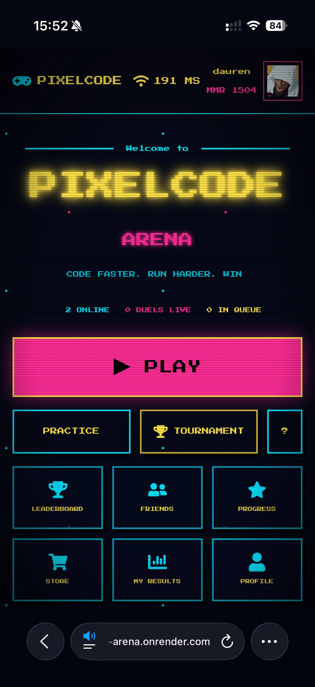
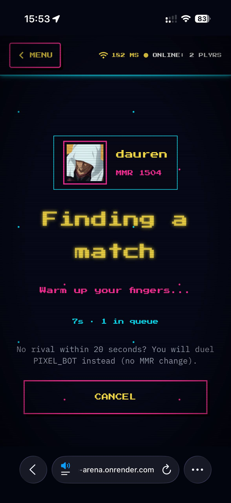
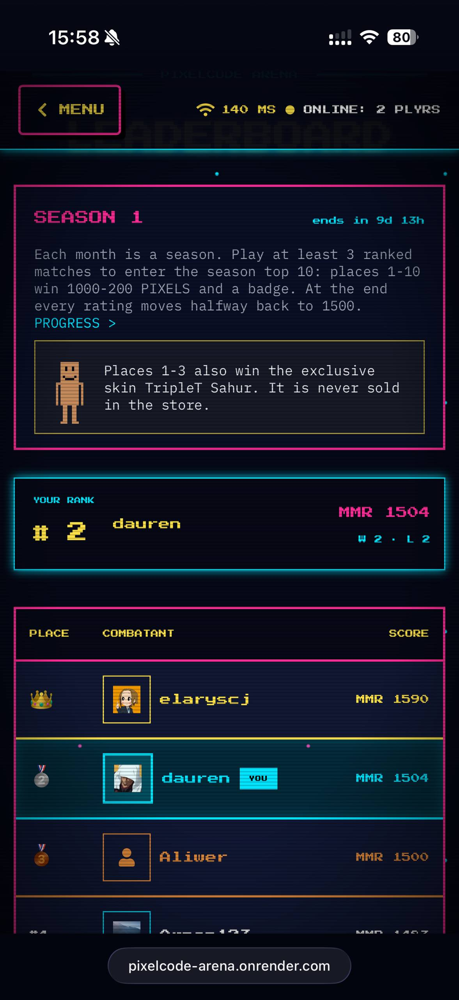
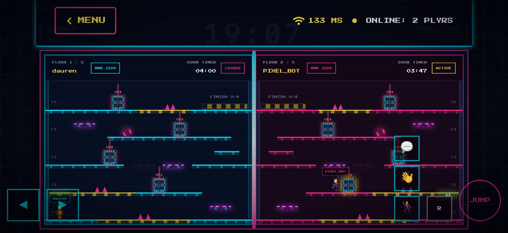
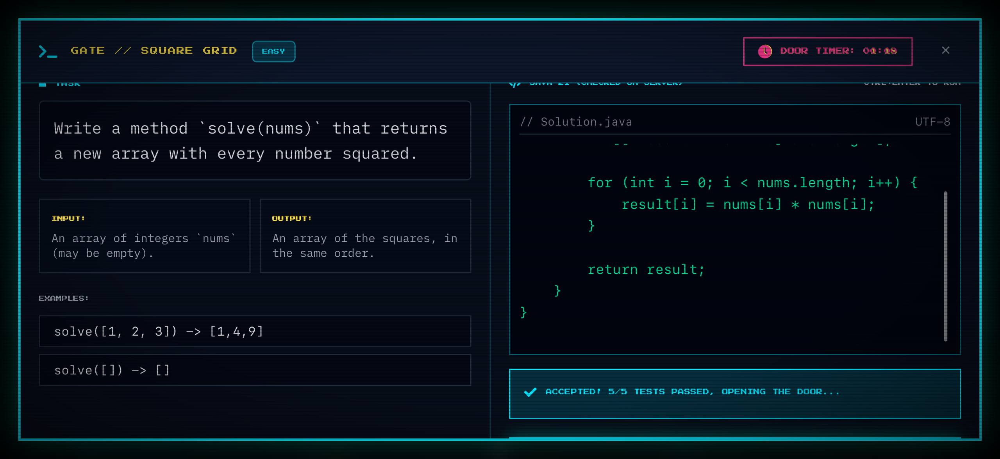
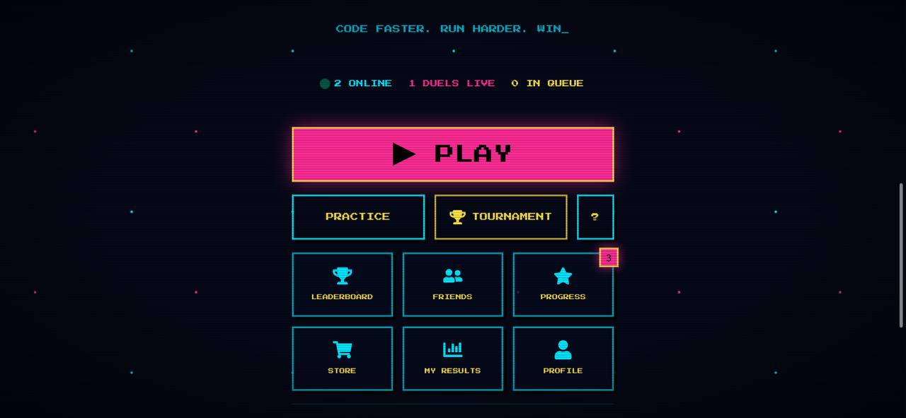
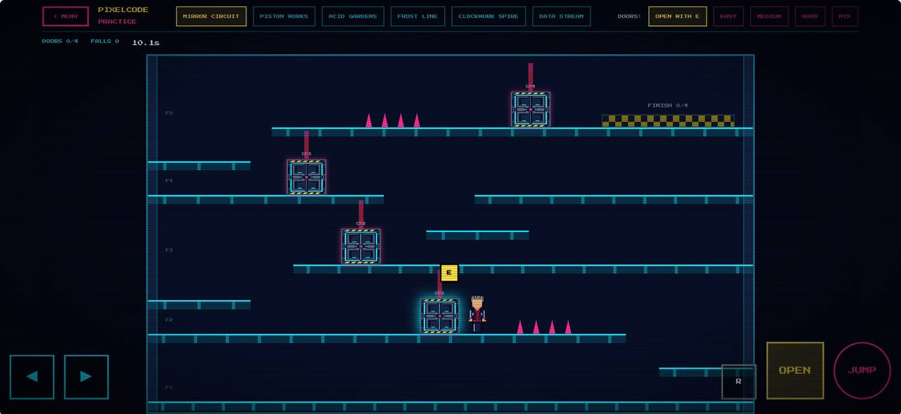
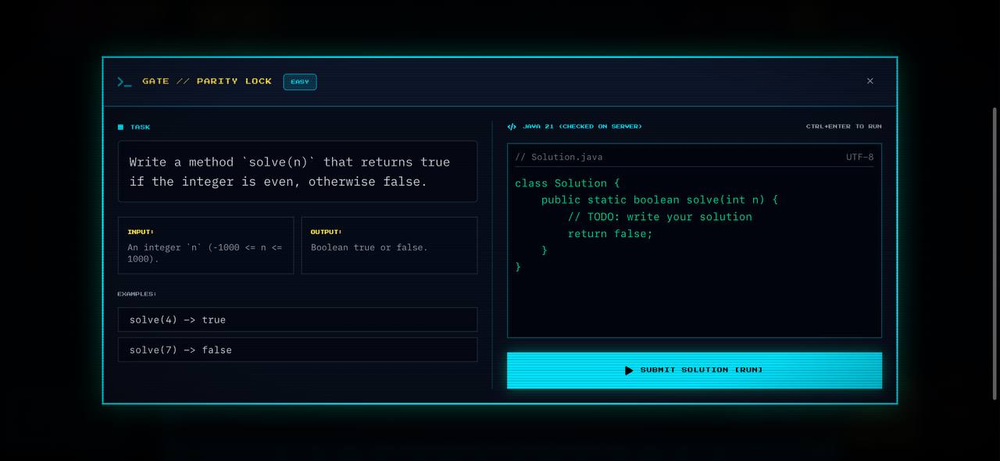
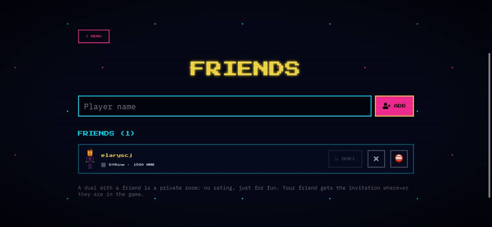

# Manual test cases (Week 10)

Every Must user story of [SRS.md](../SRS.md) has a normal case and at least one edge case. TC-01 – TC-35 are run by the script `docs/qa/run_api_tests.py` against the REST API (repeatable; Week 13 reruns it on production); TC-36 – TC-42 are checked in the browser.

**Run:** 2026-11-21T13:24:31 on a local build of `redesign-mobile` (backend at `http://localhost:8092/api`, separate database `pixelcode_qa`).
Timer cases use shortened settings so the run takes minutes, not hours: door 20 s (prod 240 s), absence 30 s (prod 300 s), join window 20 s (prod 300 s), ban 2 min (prod 30 min), bot disabled.

**Result:** 39 of 42 passed on the first run; 3 Minor failures (I-01 – I-03) were fixed and retested. No Critical or Major defects found.

| ID | Story | Test | Steps | Expected | Actual | Result |
| --- | --- | --- | --- | --- | --- | --- |
| TC-01 | US-01 | Register with valid data | POST /auth/register username=qa3537d, valid e-mail, password Passw0rd!x | 200, account created, token returned | 200, token=yes | PASS |
| TC-02 | US-01 | Register with empty fields | Submit the form with all fields empty | 400, account not created, error names a field | 400, Username must be 2-16 characters: letters, digits or underscore (field=username) | PASS |
| TC-03 | US-01 | Register a duplicate username | Register qa3537d again with a different e-mail | Refused (4xx) with a username error | 409, Username is already in use | PASS |
| TC-04 | US-01 | Register with a wrong e-mail format | E-mail = not-an-email | 400, e-mail field error | 400, Enter a valid e-mail address (field=email) | PASS |
| TC-05 | US-01 | Register with a very long username (300 chars) | Username of 300 letters | 400, username error, no server error | 400, Username must be 2-16 characters: letters, digits or underscore | PASS |
| TC-06 | US-01 | Register with a too short password | Password = 1 | 400, password error | 400, Password must be 8-72 characters (field=password) | PASS |
| TC-07 | US-02 | Sign in with valid credentials | POST /auth/login with the account from TC-01 | 200, session token | 200, token=yes | PASS |
| TC-08 | US-02 | Sign in with a wrong password / unknown user | Wrong password; then a user that does not exist | Both refused with the same generic message | 401 'Invalid username or password' / 401 'Invalid username or password' | PASS |
| TC-09 | NFR-04 | Protected data without signing in | GET /friends with no token | 401, no data | 401, Please log in again | PASS |
| TC-10 | US-09 | Enter matchmaking | Signed in, press Play (POST /matchmaking/join) | State SEARCHING | 200, SEARCHING | PASS |
| TC-11 | US-10 | Cancel matchmaking | While searching, press Cancel | State IDLE, player left the queue | 200, IDLE | PASS |
| TC-12 | US-09 | Enter matchmaking while logged out | POST /matchmaking/join without a token | 401 | 401, Please log in again | PASS |
| TC-13 | US-11 | Versus information after pairing | Two players with equal rating press Play at the same time | Matched; room shows both usernames and ratings | code=A020CB, players=['qma3537d', 'qmb3537d'], ratings=[1500, 1500] | PASS |
| TC-14 | US-32 | Time left to join is shown | Open the assigned match (GET /rooms/{code}) | Response has the join deadline | keys=['joinDeadline'] | PASS |
| TC-15 | US-12 | Both players get the same map | Both enter; compare the map of each player's state | Same mapId and door titles for both | A map 2, B map 2, same doors=True | PASS |
| TC-16 | US-13 | Locked doors block the way to the finish | Claim the finish with all doors still locked | 409, 'Unlock all doors before reaching the exit' | 409, Unlock all doors before reaching the exit | PASS |
| TC-17 | US-16 | Open a door from far away | Press E at the start, far from door 1 | 409, 'Walk up to the door first' | 409, Walk up to the door first | PASS |
| TC-18 | US-16 | Skip a door | Try to open door 2 before door 1 | 409, 'Open the previous door first' | 409, Open the previous door first | PASS |
| TC-19 | US-14 | Teleport is refused (server-confirmed position) | Report a position across the map in one step | Position not accepted | 409; position after = (4.0, 3.0) | PASS |
| TC-20 | US-16 | Open door 1 at the door | Walk to door 1, press E | Challenge with statement, input/output, starter code; door timer running | 200, title=GATE // MAX SIGNAL, timer=20s | PASS |
| TC-21 | US-14 | Opponent sees my progress | After walking, B reads the match state | B's opponent position = A's latest accepted position | B sees A at (52.25, 30.0), A is at (52.25, 30.0) | PASS |
| TC-22 | US-17 | Submit empty code | Press Submit with an empty editor | 400, 'Write some code first' | 400, Write some code first | PASS |
| TC-23 | US-19 | Submit a wrong solution | Submit the unchanged starter code | passed=false, door stays locked, feedback shown | 200, passed=False, unlocked=False, 0/5 tests, error=None | PASS |
| TC-24 | US-20 | Countdown does not reset on resubmit | Submit again (an endless loop) and compare the timer | Time left keeps going down; endless loop stopped with a time-limit or type error | 19s -> 17s, error=The parameter types of 'solve' do not fit the test data (expected a number, got [1, 5, 3, 9, 2]) | PASS |
| TC-25 | US-18 | Submit a correct solution | Submit the catalog's reference solution | passed=true, door 1 unlocked | 200, passed=True, unlocked=True | PASS |
| TC-26 | US-21 | Door opens by itself when the timer ends | Open door 2 and wait without submitting (door time 20 s in this run) | Door 2 unlocked for this player only | A unlocked=[1, 2], B unlocked=[] | PASS |
| TC-27 | US-15 | Finish the race | All doors open, walk into the exit | Match FINISHED, A is the winner | 200, status=FINISHED, winner=8 (A=8) | PASS |
| TC-28 | US-24 | Both players see the result | B opens the match after A finished | B sees FINISHED, LOSS for B, normal finish | B status=FINISHED, B result=LOSS, reason=FINISH | PASS |
| TC-29 | US-25 | Rating changes once | Read A's rating, then send the finish again | Change shown (+ for A, - for B); a repeated finish does not change it again | A delta 16, B delta -16; repeat finish 200, rating after repeat 1516 | PASS |
| TC-30 | US-34 | No-show is banned | B is matched but never enters (join window 20 s in this run) | Match ends as NO_SHOW, A wins, B is banned and cannot queue | room=FINISHED, B queue: 403 You are banned from matches for 2 more minute(s) because of an absence | PASS |
| TC-31 | US-33 | Reconnect before the deadline | B stops for 12 s (limit 30 s), then reopens the match | Match still PLAYING, B's state restored, no penalty | status=PLAYING, map=1 | PASS |
| TC-32 | US-35 | Disconnect too long = technical loss | B stays away longer than 30 s | Match ends once with reason ABSENCE, A wins | status=FINISHED, reason=ABSENCE, winner=12 (A=12) | PASS |
| TC-33 | US-22 | Admin adds a valid challenge | Admin submits a challenge whose reference solution passes | Published | 200, published=True | PASS |
| TC-34 | US-22 | Admin adds a challenge without tests | Same form with empty tests | Blocked with a specific error | 400, Field 'testsJson' is required (field=testsJson) | PASS |
| TC-35 | US-22 | A player tries the admin API | Normal player POSTs a challenge | 403 | 403, Administrator access required | PASS |
| TC-36 | NFR-04 | Logged-out access to protected pages | Signed out, open /profile, /friends, /store, /progress, /results, /teacher, /solutions/1, /watch/X, /player/1, /play/X/game | Redirect to the sign-in page | All redirect to /login; /admin shows 'Administrator access required'; /play shows 'Please log in first' | PASS |
| TC-37 | US-02 | Sign in with empty fields (UI) | Press LOG IN with both fields empty | Form error, no request | 'Enter both username and password.' | PASS |
| TC-38 | US-01 | Registration form errors (UI) | Register: 60-char name, 'bad-email', password 'short', different confirmation | Each field shows its own error | All four field errors shown under the fields | PASS |
| TC-39 | US-01 | Username length limit while typing | Type a 60-character name in the register form | Input stops at 16 (the rule) | Input allowed 20 characters, then said 'must be 2-16' (issue I-01) — Fixed: register mode limits input to 16 | FAIL → fixed, PASS on retest |
| TC-40 | US-02 | Server location on the sign-in page | Open /login, read the header | Real server location (as on other pages) | Always 'KAZAKHSTAN' (hardcoded), server is in Frankfurt (issue I-02) — Fixed: shows SERVER_REGION like other headers | FAIL → fixed, PASS on retest |
| TC-41 | NFR-08 | Pages fit a 375 px phone screen | Signed in, open every main page at 375x760 | No sideways scrolling | 15 of 16 pages fit; /admin was 672 px wide (issue I-03) — Fixed: admin page full width, title and form adapt | FAIL → fixed, PASS on retest |
| TC-42 | US-23 | Withdraw a challenge (admin) | Admin presses WITHDRAW on a challenge in /admin | Hidden from new matches; running matches keep theirs | Covered by backend: only published challenges are picked; sessions keep a snapshot | PASS |

## Coverage of the Must stories

| Story | Cases |
| --- | --- |
| NFR-04 | TC-09, TC-36 |
| NFR-08 | TC-41 |
| US-01 | TC-01, TC-02, TC-03, TC-04, TC-05, TC-06, TC-38, TC-39 |
| US-02 | TC-07, TC-08, TC-37, TC-40 |
| US-09 | TC-10, TC-12 |
| US-10 | TC-11 |
| US-11 | TC-13 |
| US-12 | TC-15 |
| US-13 | TC-16 |
| US-14 | TC-19, TC-21 |
| US-15 | TC-27 |
| US-16 | TC-17, TC-18, TC-20 |
| US-17 | TC-22 |
| US-18 | TC-25 |
| US-19 | TC-23 |
| US-20 | TC-24 |
| US-21 | TC-26 |
| US-22 | TC-33, TC-34, TC-35 |
| US-23 | TC-42 |
| US-24 | TC-28 |
| US-25 | TC-29 |
| US-32 | TC-14 |
| US-33 | TC-31 |
| US-34 | TC-30 |
| US-35 | TC-32 |

US-36 (difficulty by rating) is checked by the automated test `BotPlanTest` (`GameService.doorDifficulties`) and is Partial by design (see SRS).

## How to rerun

```bash
# local, with short timers (see the settings above)
cd backend && DB_NAME=pixelcode_qa ADMIN_USERNAMES=qa_admin PORT=8092 ./mvnw spring-boot:run -Dspring-boot.run.arguments="--game.door-seconds=20 --game.absence-seconds=30 --game.join-window-seconds=20 --game.bot-after-seconds=0 --game.newcomer-bot-after-seconds=0 --game.ban-minutes=2 --game.limits.register-per-hour=500 --game.limits.login-per-ip=500"
python3 docs/qa/run_api_tests.py http://localhost:8092/api --short-timers
# production (timer cases are skipped; creates a few qa* test accounts)
python3 docs/qa/run_api_tests.py https://pixelcode-api.onrender.com/api
```

## Staging run (Week 11 deployment check)

21 November 2026, `python3 docs/qa/run_api_tests.py https://https-dashboard-render-com-fbww.onrender.com/api` (normal timers): **29 passed, 0 failed, 6 skipped** (TC-26, TC-30 – TC-32 need short timers; TC-33 – TC-34 need the test account to be an admin there). Results: `results-2026-11-21-staging.json`.
Browser check on https://pixelcode-staging.onrender.com: a new account registered through the form, the main menu opened, header shows the Frankfurt server.
Found during the staging setup: `VITE_API_URL` must not end with `/api` (the site adds it); the docs said otherwise and were corrected.
Admin checks on staging with the team's admin accounts (`dauren`, `Arman123` from `ADMIN_USERNAMES`): TC-33 valid challenge published — PASS; TC-34 challenge without tests refused ("Field 'testsJson' is required") — PASS; a challenge whose reference solution fails its own tests refused ("passes only 1 of 2 tests") — PASS; TC-42 withdraw sets published=false — PASS; admin STATS opens — PASS; TC-35 a normal player gets 403 on the admin API and on STATS — PASS.

## Production rerun (Week 13)

24 November 2026, after `main` was merged into `release` (PR #33) and Render redeployed production: `python3 docs/qa/run_api_tests.py https://pixelcode-api.onrender.com/api` (normal timers): **29 passed, 0 failed, 6 skipped**, the same as on staging (TC-26, TC-30 – TC-32 need short timers; TC-33 – TC-34 need the test account to be an admin). Results: `results-2026-11-24-prod.json`.
I-04 checked on production: an unknown address (`/api/no-such-thing`) now returns 404 instead of 500.

## Production rerun after v0.9.1-beta (new maps)

24 November 2026, after `main` was merged into `release` (PR #36) and Render redeployed both services: the door and exit tables in `run_api_tests.py` follow the rebuilt maps. `python3 docs/qa/run_api_tests.py https://pixelcode-api.onrender.com/api`: **29 passed, 0 failed, 6 skipped** (same skips as before). Results: `results-2026-11-24-prod-v0.9.1.json`. The same run against a local server with the new maps gave the same result.
Found while testing: during a deploy the site can update a few minutes before the backend; until both are live the old server refuses doors at the new positions ("Walk up to the door first") and the bot follows the old layout. Check that both Render services show the new commit before playing.

## Production check from another device (Week 11)

21 November 2026, a team member's iPhone (account `dauren`), https://pixelcode-arena.onrender.com: main menu (portrait and landscape), Quick Play search, a match against PIXEL_BOT with touch controls, a door solved ("Accepted! 5/5 tests passed"), leaderboard with "your rank", practice, a door challenge, friends. Everything worked; no new defects. Registration of a brand-new account was checked the same day on staging (browser) and by TC-01.

| Menu | Quick Play search | Leaderboard |
| --- | --- | --- |
|  |  |  |

| Match against PIXEL_BOT (touch controls) | Door solved on the phone |
| --- | --- |
|  |  |

| Menu (landscape) | Practice (touch controls) | Door challenge | Friends |
| --- | --- | --- | --- |
|  |  |  |  |
